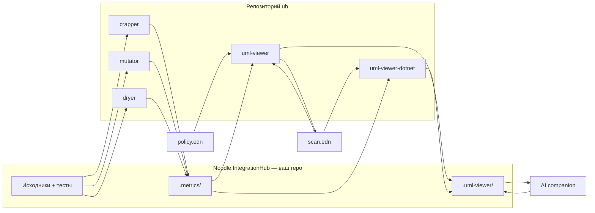

# Полный цикл: инструменты UB (для человека, который видит это впервые)

Эта папка **`ub`** — рабочий набор [форков Noodle-cpp](README.ru.md) для **качества кода** и **UML-диаграммы с агентом**.  
Вы **не** запускаете всё из корня `ub`. Вы работаете **в своём проекте** (solution, репозиторий приложения), а инструменты вызываете из соседних каталогов или через PATH.

---

## 0. Одна фраза: зачем всё это

1. **crapper** — «насколько функция страшная и плохо покрыта тестами» → файл **`.metrics/crap.edn`**.  
2. **mutator** — «убивают ли тесты искусственные поломки кода» → **`.metrics/mutate/*.edn`**.  
3. **dryer** — «нет ли копипасты» → **`.metrics/dry.edn`** (viewer её почти не рисует, но файл полезен вам и агенту).  
4. **uml-viewer** (Clojure) или **uml-viewer-dotnet** — **картинка** архитектуры + те же метрики цветом + кнопки для агента.  
5. **ub-mode** — **правила для AI-агента**: сначала заставь работать, потом прогони crapper/dryer/mutator.

**Золотое правило:** все метрики и почта агента живут **в корне анализируемого проекта**, не в `ub`.

**В этой инструкции все пути выдуманы.** Подставьте свои каталоги, сохранив смысл:

| В тексте | Что это у вас |
|----------|----------------|
| `D:\tools\ub` | где лежит клон репозитория `ub` |
| `D:\dev\Noodle.IntegrationHub` | корень **вашего** приложения (solution / repo) |
| `Noodle.IntegrationHub.*` | вымышленные namespace (префикс **Noodle** — как ник, не про еду; учебный «корп»-стиль) |

---

## 1. Карта каталога `ub`

| Репозиторий | Что делает | Куда пишет результат |
|--------|------------|----------------------|
| [Noodle-cpp/crapper](https://github.com/Noodle-cpp/crapper) | CRAP, сложность, покрытие | `<ваш-проект>/.metrics/crap.edn` |
| [Noodle-cpp/mutator](https://github.com/Noodle-cpp/mutator) | мутационные тесты | `<ваш-проект>/.metrics/mutate/` |
| [Noodle-cpp/dryer](https://github.com/Noodle-cpp/dryer) | дубли кода | `<ваш-проект>/.metrics/dry.edn` |
| [Noodle-cpp/uml-viewer](https://github.com/Noodle-cpp/uml-viewer) | IR из policy, Quil-окно, `./uml` + Grok | IR `.edn`, `.uml-viewer/` |
| **uml-viewer-dotnet** (рядом в workspace) | то же без JVM (Avalonia) | читает те же `.metrics` и IR |
| [Noodle-cpp/ub-mode](https://github.com/Noodle-cpp/ub-mode) | skill для Cursor/Grok | `SKILL.md` — копируете к себе |

**mutator** при первом запуске ищет **crapper рядом**: `../crapper` от папки `mutator`. В layout `ub` это уже так — ничего настраивать не нужно.

---

## 2. Что должно быть у «вашего проекта»

Пример: вымышленный C# solution **`Noodle.IntegrationHub`** — сервис оркестрации синхронизации с внешними CMDB/API (учебный проект, не ваш рабочий репозиторий).

```
D:\dev\Noodle.IntegrationHub\
  Noodle.IntegrationHub.Application\   ← сценарии, handlers
  Noodle.IntegrationHub.Domain\        ← контракты, модели
  Noodle.IntegrationHub.Infrastructure\
  Noodle.IntegrationHub.Tests\         ← тесты (нужны crapper/mutator)
  .metrics\                        ← появится после crapper/mutator/dryer
      crap.edn
      mutate\*.edn
      dry.edn
  .uml-viewer\                     ← появится при ./uml или работе viewer
      to-agent.edn
      to-viewer.edn
      session.edn
      companion.edn                  ← если запускали companion
```

Для **C#** namespace в метриках = **`Namespace.Type`** (как в IDE). Это должно совпадать с IR uml-viewer — см. [csharp-project.ru.md](https://github.com/Noodle-cpp/uml-viewer/blob/master/docs/csharp-project.ru.md).

---

## 3. Подготовка (Windows)

### Python-инструменты (crapper, mutator, dryer)

Первый запуск создаёт `.venv` внутри каждой папки.

**Вариант A — Git Bash / WSL** (как в README):

```bash
cd /d/tools/ub/crapper
./crapper --help
```

**Вариант B — PowerShell** (без `./crapper`):

```powershell
cd D:\tools\ub\crapper
python -m venv .venv
.\.venv\Scripts\pip install -e .
.\.venv\Scripts\python -m crapper --help
```

То же для `mutator` и `dryer`: `python -m mutator`, `python -m dryer`.

### Clojure viewer

- Установите [Clojure CLI](https://clojure.org/guides/install_clojure) и **Java 21+**.
- Для Windows часто: `Import-Module ClojureTools` и команда `clj`.

### .NET viewer (опционально)

- [.NET 8 SDK](https://dotnet.microsoft.com/download).
- Подробности: [uml-viewer-dotnet/docs/USAGE.ru.md](uml-viewer-dotnet/docs/USAGE.ru.md) в локальном checkout или после публикации форка.

---

## 4. Полный цикл — по шагам (первый раз)

Дальше **`PROJECT`** = корень вашего solution — в примерах это **`D:\dev\Noodle.IntegrationHub`**.

```text
  [тесты проходят]
        ↓
   ① crapper  →  .metrics/crap.edn
        ↓
   ② mutator  →  .metrics/mutate/*.edn
        ↓
   ③ dryer    →  .metrics/dry.edn   (можно пропустить на старте)
        ↓
   ④ policy   →  clj -M:ir          →  scan.edn (IR)
        ↓
   ⑤ viewer   →  диаграмма + цвета CRAP/M
        ↓
   ⑥ агент    →  Regen, правки кода, снова ①–④
```

### Шаг ① — CRAP (crapper)

```powershell
cd D:\tools\ub\crapper
.\.venv\Scripts\python -m crapper "D:\dev\Noodle.IntegrationHub"
```

Или из корня проекта (если `crapper` в PATH или через скрипт):

```bash
cd /d/dev/Noodle.IntegrationHub
../ub/crapper/crapper
```

**Что получите:** таблица в консоли + файл **`D:\dev\Noodle.IntegrationHub\.metrics\crap.edn`**.  
**Если долго:** сначала один модуль:

```bash
./mutator Noodle.IntegrationHub.Application/Sync/SyncOrchestrator.cs
./crapper Noodle.IntegrationHub.Application/Sync
```

Полезные флаги:

- `--no-coverage` — только сложность, без CRAP-числа.  
- `--use-existing-coverage` — не гонять тесты заново.  
- `--changed` — только файлы из git.

### Шаг ② — мутации (mutator)

**Сначала** должен отработать crapper (имена namespace/методов общие).

```powershell
cd D:\tools\ub\mutator
.\.venv\Scripts\python -m mutator `
  "D:\dev\Noodle.IntegrationHub\Noodle.IntegrationHub.Application\Sync\SyncOrchestrator.cs"
```

Первый прогон по **всему** дереву может занять часы. Начинайте с **одного файла**, над которым работаете.

Код выхода:

- `0` — все запущенные мутанты убиты.  
- `3` — кто-то выжил (тесты слабые).  
- `2` — baseline-тесты уже падают (чините тесты, не mutator).

**Результат:** `D:\dev\Noodle.IntegrationHub\.metrics\mutate\Noodle.IntegrationHub.Application.Sync.SyncOrchestrator.edn` (имя файла зависит от namespace).

### Шаг ③ — дубли (dryer), по желанию

```powershell
cd D:\tools\ub\dryer
.\.venv\Scripts\python -m dryer "D:\dev\Noodle.IntegrationHub\Noodle.IntegrationHub.Application"
```

**Результат:** `D:\dev\Noodle.IntegrationHub\.metrics\dry.edn`. Viewer на карточке dry не рисует, но агент с ub-mode этим пользуется.

### Шаг ④ — policy и IR (граф для диаграммы)

IR **не правят руками**. Правят **policy**, потом генерируют IR.

1. Создайте файл policy рядом с solution, например `D:\dev\Noodle.IntegrationHub\integration-hub.policy.edn`:

```clojure
{:title "Noodle Integration Hub"
 :prefix "Noodle.IntegrationHub"
 :hierarchical true
 :sources
 [{:lang :csharp
   :root "D:/dev/Noodle.IntegrationHub/Noodle.IntegrationHub.Application"}
  {:lang :csharp
   :root "D:/dev/Noodle.IntegrationHub/Noodle.IntegrationHub.Domain"}
  {:lang :csharp
   :root "D:/dev/Noodle.IntegrationHub/Noodle.IntegrationHub.Infrastructure"}]}
```

В репозитории `uml-viewer` есть **другие** примеры policy (для демо viewer’а) — для своего кода удобнее файл **в каталоге проекта**, как выше.

2. Сгенерируйте IR:

```powershell
cd D:\tools\ub\uml-viewer
clj -M:ir D:\dev\Noodle.IntegrationHub\integration-hub.policy.edn `
        D:\dev\Noodle.IntegrationHub\integration-hub.ir.edn
```

Формат команды: `clj -M:ir <policy.edn> <куда-писать-ir.edn>`.

3. Проверка (опционально, .NET):

```powershell
cd D:\tools\ub\uml-viewer-dotnet
dotnet run --project src\UmlViewer.Cli -- overlay-check `
  D:\dev\Noodle.IntegrationHub\integration-hub.ir.edn `
  --root "D:\dev\Noodle.IntegrationHub"
```

Если «Missing namespace» — IR не видит классы, которые есть в crap.edn: поправьте `:prefix` / `:sources` в policy.

### Шаг ⑤ — открыть диаграмму

#### Вариант A — Clojure (полный цикл с `./uml` и Grok)

В **корне анализируемого проекта** (не в `ub`):

```bash
# один раз: скачать скрипт и положить ./uml
curl -fsSL .../get-uml-viewer -o get-uml-viewer   # см. uml-viewer/README.ru.md
./get-uml-viewer
```

Или вручную из checkout:

```powershell
cd D:\dev\Noodle.IntegrationHub
clj -M:uml-viewer --root "D:\dev\Noodle.IntegrationHub" `
  D:\dev\Noodle.IntegrationHub\integration-hub.ir.edn
```

(алиас `:uml-viewer` должен быть в `deps.edn` проекта или запуск из каталога uml-viewer с путями.)

**Первый запуск с `./uml`:** canvas может быть пустой — «Waiting for agent» — пока companion не пришлёт `:display`. Если IR **уже лежит на диске**, свежий uml-viewer при старте **сам подгружает файл** (без ожидания). Клавиша **`R`** — перечитать IR.

#### Вариант B — .NET (без JVM, без auto-Grok)

```powershell
cd D:\tools\ub\uml-viewer-dotnet
dotnet run --project src\UmlViewer.App -- `
  --root "D:\dev\Noodle.IntegrationHub" `
  --ir "D:\dev\Noodle.IntegrationHub\integration-hub.ir.edn"
```

IR и `.metrics` обновились — viewer **сам перечитает** (mtime). Companion на Windows через tmux — редкость; команды агента всё равно попадают в **`to-agent.edn`**.

---

## 5. Как читать диаграмму (оба viewer’а)

| Действие | Эффект |
|----------|--------|
| Двойной клик по **пакету** | «провалиться» внутрь namespace |
| Двойной клик по **классу** | карточка: методы, CRAP, CC, coverage, mutation |
| Клик по методу в карточке | открыть `.cs` / `.clj` на строке |
| **Declutter** | упростить стрелки (несколько режимов) |
| **Real diagram** / заголовок IR | «настоящая» архитектура из кода |
| **+ New proposal** | «what-if» слой; **не** меняет код, пока вы не попросите агента |
| **Regen** | очередь `:regen` → companion перепишет policy/IR и метрики |
| ПКМ по классу | Refresh CRAP / Mutation / Omit → очередь для агента |

**Цвета и буквы C / M** — из `.metrics/`. Красные зависимости — нарушение dependency rule из `:levels` в policy.

---

## 6. Почта агента (`.uml-viewer/`)

Всё в каталоге проекта, например **`D:\dev\Noodle.IntegrationHub\.uml-viewer\`**:

| Файл | Направление | Смысл |
|------|-------------|--------|
| `to-agent.edn` | viewer → агент | «сделай regen / обнови crap / omit» |
| `to-viewer.edn` | агент → viewer | «покажи другой IR» / «закройся для restart» |
| `session.edn` | viewer | камера, drill, proposal (для `--restart`) |
| `companion.edn` | система | имя tmux-сессии Grok |

Viewer **не** выполняет regen сам — он **ставит задачу** агенту. Агент (Grok с ub-mode / uml-viewer rules) читает очередь и запускает crapper, mutator, `clj -M:ir`.

Типичный цикл агента после вашего **Regen**:

1. Прочитать `to-agent.edn` (`:regen` или `:refresh-crap`).  
2. `crapper` / `mutator` / `clj -M:ir`.  
3. Записать в `to-viewer.edn` `{:op :display :path "…"}` или `:quit-for-restart`.  
4. Viewer обновился.

---

## 7. ub-mode — если работаете с AI в Cursor

1. Скопируйте [ub-mode/SKILL.md](https://github.com/Noodle-cpp/ub-mode/blob/master/SKILL.md) в каталог skills агента (см. [README.ru.md](https://github.com/Noodle-cpp/ub-mode/blob/master/README.ru.md)).  
2. Вызовите `/ub-mode` или включите skill.  
3. Агент должен: **сначала** рабочий код и тесты, **потом** пороги CRAP &lt; 10, dry &lt; 0.8, mutator без выживших.

Это **не** заменяет ручной запуск crapper — это дисциплина **когда** их гонять.

---

## 8. Пример «один рабочий день» (вымышленный Noodle.IntegrationHub)

Сначала один раз задайте три переменные **под свой диск** (здесь — выдуманные пути):

```powershell
$PROJECT = "D:\dev\Noodle.IntegrationHub"
$UB      = "D:\tools\ub"
$POLICY  = "$PROJECT\integration-hub.policy.edn"
$IR      = "$PROJECT\integration-hub.ir.edn"
```

Сценарий: вы правите **`SyncOrchestrator.cs`**, хотите увидеть CRAP на диаграмме и отправить агенту «обнови mutation».

```powershell
# 0. Тесты должны проходить
dotnet test $PROJECT\Noodle.IntegrationHub.Tests\Noodle.IntegrationHub.Tests.csproj

# 1. Метрики (узко — один файл)
& "$UB\mutator\.venv\Scripts\python.exe" -m mutator `
  "$PROJECT\Noodle.IntegrationHub.Application\Sync\SyncOrchestrator.cs"

& "$UB\crapper\.venv\Scripts\python.exe" -m crapper `
  "$PROJECT\Noodle.IntegrationHub.Application\Sync"

# 2. IR из policy проекта
Set-Location "$UB\uml-viewer"
clj -M:ir $POLICY $IR

# 3. Диаграмма (.NET viewer)
Set-Location "$UB\uml-viewer-dotnet"
dotnet run --project src\UmlViewer.App -- --root $PROJECT --ir $IR
```

Дальше в UI: drill в `Noodle.IntegrationHub.Application` → класс **`SyncOrchestrator`** с высоким CRAP → ПКМ **Refresh Mutation** → в `$PROJECT\.uml-viewer\to-agent.edn` появилась команда → агент дописывает тесты → снова mutator на тот же файл.

**Clojure-проект** (вымышленный **`Noodle.Policy.Engine`**) — валидация архитектурных policy для uml-viewer; та же петля метрик:

```bash
cd /d/dev/Noodle.Policy.Engine
/d/tools/ub/crapper/crapper src/noodle/policy
/d/tools/ub/mutator/mutator src/noodle/policy/validate.clj
cd /d/tools/ub/uml-viewer
clj -M:ir /d/dev/Noodle.Policy.Engine/engine.policy.edn \
           /d/dev/Noodle.Policy.Engine/engine.ir.edn
```

---

## 9. Частые глупости (и как не наступить)

| Симптом | Причина | Что сделать |
|---------|---------|-------------|
| Пустая диаграмма, «waiting» | IR ещё нет, ждёте agent | Сгенерируйте `clj -M:ir` или откройте существующий `.edn` |
| Нет точек C/M | Нет `.metrics` или не тот `--root` | Запустите crapper/mutator **из корня PROJECT** |
| Namespace не матчится | IR и crap.edn разные `:ns` | Policy `:prefix` / `:sources`; `overlay-check` |
| mutator ругается на crapper | Нет `../crapper` | Держите репозитории как в `ub` или установите crapper рядом |
| `./crapper` не работает в PowerShell | Это sh-скрипт | `python -m crapper` из venv |
| Regen «ничего не произошло» | Нет companion | Читайте `to-agent.edn` вручную или настройте Grok |
| Правлю `.edn` IR руками | Так нельзя | Правьте **policy**, потом `clj -M:ir` |
| Тесты падают | mutator exit 2 | Сначала `dotnet test` / `clj -M:test` |

---

## 10. Куда копать глубже

| Тема | Документ |
|------|----------|
| CRAP, языки, покрытие | [Noodle-cpp/crapper — README.ru.md](https://github.com/Noodle-cpp/crapper/blob/master/README.ru.md) |
| Мутации, воркеры | [Noodle-cpp/mutator — README.ru.md](https://github.com/Noodle-cpp/mutator/blob/master/README.ru.md) |
| Дубли | [Noodle-cpp/dryer — README.ru.md](https://github.com/Noodle-cpp/dryer/blob/master/README.ru.md) |
| Policy, `./uml`, companion | [Noodle-cpp/uml-viewer — README.ru.md](https://github.com/Noodle-cpp/uml-viewer/blob/master/README.ru.md) |
| C# scan + overlay | [uml-viewer/docs/csharp-project.ru.md](https://github.com/Noodle-cpp/uml-viewer/blob/master/docs/csharp-project.ru.md) |
| .NET viewer по шагам | [uml-viewer-dotnet/docs/USAGE.ru.md](uml-viewer-dotnet/docs/USAGE.ru.md) (в локальном checkout) |
| Дисциплина агента | [Noodle-cpp/ub-mode — README.ru.md](https://github.com/Noodle-cpp/ub-mode/blob/master/README.ru.md) |
| Обзор форков | [README.ru.md](README.ru.md) |

---

## 11. Мини-схема (распечатайте mentally)



**Итог:** вы постоянно крутите петлю **тесты → метрики → IR → картинка → агент правит код → снова метрики**. Инструменты в `ub` — завод; ваш **PROJECT** — место, где лежат `.metrics`, policy/IR (куда вы их положите) и `.uml-viewer`.
